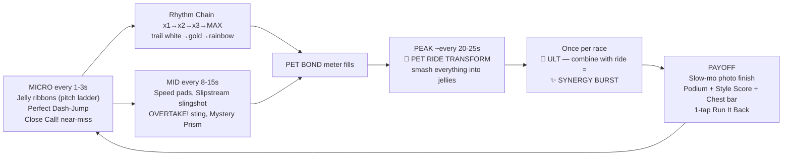

# ☁️🏃‍♀️🐉 SKY CLOUD DASH V2 — 3D Curved Party Race (*Tales Runner × Mario Kart × Cookie Run*)
**Status:** Design Spec v2.1 — ✅ **6B-1 Core Run** and ✅ **6B-2 Party Layer** shipped (slipstream, Mystery Prism items with server-routed Shrink/Mochi/Slow, 5 ULT archetypes + Synergy Burst, `shared/universal_stats.js` + `shared/dash_builds.js` builds with tier perks, Build Badge + Build Card). Next: 6B-3. All numbers live in `DASH_TUNING` / `DASH_CAPS` and are tunable.
**Target Screen:** `Screen 15` (`MODES.cloud_dash` in `shared/universal_room.js`)
**Visual Reference:** [`cloud_dash_style2_prototype_1791989036675.jpg`](file:///Users/thanapat/Documents/neora-world-v3/neora_world_v2_export/assets/cloud_dash_style2_prototype_1791989036675.jpg)

---

## 0. 🎯 Design North Star

> **"Every 2 seconds something feels good. Every 20 seconds something feels AMAZING. Every race ends with a reward — even in 4th."**

Three rules every mechanic must pass:
1. **Dopamine Cadence**: it fits into the micro → mid → peak → payoff loop (§1).
2. **Frictionless**: one thumb, forgiving timing, never a black screen, never a "you're out" (§6).
3. **Readable at speed**: one glance tells you what happened and why.

A **little pay-to-win is intended**: better gear/pets/costumes give a felt-but-beatable edge (≈ 5–8% race-time advantage at max), and soft rubber-banding stops anyone from running away with it (§5).

---

## 1. 🧪 The Dopamine Loop (the core of this mode)



| Layer | Cadence | Feel-good beats |
|---|---|---|
| **Micro** | 1–3 s | Jelly pickup with a rising pitch ladder (resets after 1.2 s gap), `NICE DASH!` perfect landings, `CLOSE CALL!` near-misses (+ult, +bond), lane-swap whoosh |
| **Chain** | continuous | **Rhythm Chain** counter: every pickup / perfect / near-miss +1. Tiers `x1 → x2 (10) → x3 (25) → MAX (50)` multiply Style Score & Pet Bond gain. Getting hit drops **one tier** (not to zero — frictionless). |
| **Mid** | 8–15 s | Rainbow speed pads, Slipstream slingshot, **`OVERTAKE! 3rd → 2nd`** banner + avatar swap on the race bar, Mystery Prism roll |
| **Peak** | ~20–25 s | **🐾 Pet Ride Transform** (§2) — the "Bonus Time" moment. ~2–3 per race. |
| **Climax** | 1× per race | **🌈 Costume Ultimate**; fired during a Pet Ride → **✨ SYNERGY BURST** |
| **Payoff** | race end | Slow-mo photo finish, podium, **two scoreboards** (Placement + Style Score), chest-progress bar, mission ticks, `NEW BEST!` stamps, 1-tap rematch |

**Two scoreboards** = nobody loses everything. 4th place with a `NEW BEST STYLE 48,210!` still walks away happy and still progresses missions, chest bar, and league XP.

---

## 2. 🐾 SIGNATURE MECHANIC — Pet Ride Transform

Your Companion Pet runs/flies beside you the whole race. Fill its **Pet Bond Meter** and it **transforms 3× giant and you ride it**.

### 2.1 Filling the meter (paw ring around the pet portrait, HUD top-right)
| Source | Bond |
|---|---|
| Jelly / coin | +0.6 |
| `NICE DASH!` perfect landing | +6 |
| `CLOSE CALL!` near-miss | +4 |
| Overtake | +5 |
| Slipstream slingshot | +3 |
| Rhythm Chain tier multiplier | ×1 / ×1.25 / ×1.5 / ×2 |
| Catch-up (3rd / 4th place) | ×1.15 / ×1.3 |

Target: first ride at ~18–22 s, **2–3 rides per race** for an average player.

### 2.2 The transform (auto-triggers at 100% — zero extra buttons)
1. `0.5s` cinematic: pet glows, swells 3×, Chibi hops onto its back, camera pulls back +1.5 m, FOV +10°, bass drop + haptic pulse.
2. **Ride lasts `5.0s`** (+ pet star / passive bonuses). During the ride:
   - `1.45×` speed, **invulnerable**, auto-magnet across all 3 lanes.
   - Every hurdle you touch is **SMASHED** into a jelly burst (40 ms hit-stop + bounce text `SMASH!`).
   - Lane changes and jumps still work (rider still feels in control).
3. **Dismount Dash**: tap JUMP within the dismount window → `NICE DASH!` boost and keeps the chain alive. Riding feels great *and* ends on a skill beat.

### 2.3 Per-family ride styles (the 4 V2 families; legacy pets map via `LEGACY_PET_MAP`)
| Pet family | Ride | Signature effect |
|---|---|---|
| 🐱 **Ragdoll** (`pet_ragdoll`) | **Royal Pounce** | Bounding leaps auto-clear hurdles; magnet radius ×2; each landing pops a heart shockwave of jellies |
| 🐉 **Nyx Drake** (`pet_nyx`) | **Sky Flight** | Flies at `y = 2.5m` over everything; plasma breath clears 30 m of your lane ahead |
| 🦊 **Sakura Kitsune** (`pet_kitsune`) | **Foxfire Blink** | Lane swaps are instant blinks leaving foxfire clones; each blink +3% speed (stacks ×5) |
| 🐋 **Sky Whale** (`pet_skywhale`) | **Whale Surf** | Surfs a bubble wave; rivals behind you in your lane get bubbled (−20% for 1 s) |

### 2.4 Progression hook (soft P2W)
| Pet star | Ride duration | Bond gain |
|---|---|---|
| ★1 | 5.0 s | ×1.00 |
| ★2 | 5.5 s | ×1.08 |
| ★3 | 6.0 s + **golden ride skin** | ×1.15 |

Existing `pet_skills.js` `cloud_dash` passives still apply on top (rebalanced in §5.3).

---

## 3. 🕹️ Controls & Core Movement (one thumb, zero friction)

### 3.1 Input grammar
| Input | Grounded | Airborne |
|---|---|---|
| **Swipe ← / →** or tap `[⬅️] [➡️]` | Lane change (`110ms` eased, cancelable mid-swap) | Air-strafe lane change |
| **Swipe ↑** or tap `[🪽 JUMP]` | Jump. If within the **Perfect window** after landing → **Dash-Jump** (low hop + `+25%` for `1.4s` + `NICE DASH!`) | Air-hop (if hops left) |
| **Hold** `[🪽]` | — | Glide (only after jump apex) |
| Tap `[🌈 ULT]` | Fire Ultimate (pulses when ready) | same |
| Tap item bubble (above ULT) | Use item | same |

Both swipe-anywhere and buttons work simultaneously; player picks in settings (default: both).

### 3.2 Forgiveness layer (invisible, always on)
| Assist | Value |
|---|---|
| **Input buffer** (jump / lane pressed slightly early) | `150 ms` |
| **Coyote time** (jump after leaving a cliff lip) | `100 ms` |
| **Perfect window** | `180 ms` base → up to `230 ms` (🍀 Luck) |
| Player hurtbox vs visual | `70%` |
| Pickup hitbox vs visual | `150%` + baseline magnet `0.6 m` |
| Near-miss (`CLOSE CALL!`) | Obstacle passes within `0.35 m` / lane-swap within `150 ms` of impact |
| Lane snap | Auto-centers; "same lane" checks use `Math.round(lane)` |

### 3.3 Getting hit — never punishing, never a black screen
| Event | Result |
|---|---|
| Hit a hurdle | **Stumble**: `−35%` for `0.6s`, `1.0s` i-frames, chain drops one tier |
| Miss a gap / fall | **🐾 Pet Rescue**: your pet swoops in and catches you (0.8 s cute cinematic), you land back on track `−8m`, lose `25` Bond. No respawn screen. |
| Hit while shielded / riding | Nothing — shield pops / hurdle smashes |

---

## 4. 🔥 Party-Race Interaction (rebalanced)

| Mechanic | Rule | Dopamine beat |
|---|---|---|
| **💨 Slipstream** | Same lane, `Δs < 12m` behind a rival for `1.2s` → **`+35%` slingshot for `1.2s`** | Golden wind lines build up, then `SLINGSHOT!` |
| **👟 Hop-Over Vault** *(replaces Head-Stomp)* | Jump over a rival in your lane (`y > 0.6m`, server detects Δs sign flip between ticks) → **`+20%` for `1.0s`**; victim gets a 0.3 s comedic squash (no slow) | `VAULT!` + rival's squash — fun for both, no latency disputes |
| **💞 Heart Slingshot** *(replaces constant Tether)* | Bound Partner / Friend within 1 lane & `15m` fills a shared heart meter (~15 s). When full, either taps their portrait → **both get `+30%` for `1.5s`** + heart-trail VFX | Coordinated couple moment, not a permanent buff |
| **🏎️ Apex Carve** | Inside lane on a curve → `+10%` speed while carving. Hairpins place hazards on the inside lane (risk/reward). **No centrifugal pull.** | `⚡ APEX!` sparks |
| **🏁 Overtake** | Any position gain → banner + race-bar avatar swap + `+5` Bond | Constant small wins in a 4P pack |

---

## 5. ⚖️ Speed, Balance & Soft Pay-to-Win

### 5.1 Speed model (bounded — no 8× blowups)
```
speed = BASE × zoneMul × (1 + statSpeed) × (1 + catchUp) × (1 + activeBoost)
activeBoost = max(all active boosts)          // strongest wins; others only refresh timers
caps: boosts 1.6× · Pet Ride 1.45× (+boost on top, still ≤1.6×) · Ult ≤1.8× · Synergy Burst ≤1.9×
```
| Constant | Value |
|---|---|
| `BASE` | `12 m/s` |
| `zoneMul` | Z1 `1.00` · Z2 `1.05` · Z3 `1.15` (ice) · Z4 `1.25` (200cc) |
| Track length | `1,000 m` → average race ≈ **70–78 s** |
| **Displayed km/h** (stylized) | `m/s × 3.6 × 3` → cruise **~130**, boosted **~190**, ride/ult **~230 km/h** |
| Mach Wing Overdrive | 3 chained perfects **or** Chain MAX → visual-only tier (wider FOV, double trail, golden speed lines) + `+5%` |

### 5.2 Universal Stats in Cloud Dash (`DASH_CAPS`, same soft-cap curve as `MB_CAPS`)
| Stat | Effect (soft-capped max) |
|---|---|
| 🔥 **Power** | Ult charge `+20%`, Speed-pad & smash boost duration `+20%` |
| ⚡ **Swiftness** | **Top speed `+6%`**, glide time `+15%`, slipstream fill `−20%` |
| 🪙 **Fortune** | Magnet reach `+40%`, Style Score `+15%`, podium rewards `×1.0–3.0` |
| 🍀 **Luck** | Perfect window `180 → 230 ms`, better Prism rolls, chest% |

### 5.3 Soft pay-to-win budget (felt, not decisive)
| Source | Max race-time edge |
|---|---|
| Raw stats (§5.2, soft-capped) | ~4–5% |
| **Dash Build tier perks (§5.5)** | Tier II ~3% · Tier III ~5% · **✦ Tier IV ~7%** |
| Pet ★3 (longer ride, faster bond) | ~2% |
| Super Mythic ult (`+15%` budget over Season ults) | ~1–2% |
| **Total vs. a fresh account** | **≈ 6–8% (mid F2P) · up to ≈ 12% (✦ Sovereign whale)** |
| **Counterweight**: invisible catch-up `catchUp` | 3rd `+3%`, 4th `+6%`, plus ×1.15 / ×1.3 Bond gain |

Pet passive rebalance (`shared/pet_skills.js` `cloud_dash`, after `PET_MODE_SCALE 0.85`):
| Pet | Current | New |
|---|---|---|
| 🐋 `bubble_shield.shieldCooldownSec` | `[20, 16, 12]` | `[30, 25, 20]`, max 3 per race |
| 🦊 `foxfire.extraAirHops` | `[1, 1, 2]` | `[1, 1, 1]` + ★3 `+15%` hop height |
| 🐱 `royal_charm.jellyMagnetRadiusM` | `[0.5, 0.5, 0.75]` | `[0.8, 1.0, 1.3]` |
| 🐉 `plasma_blast.feverDurationBonusSec` | `[0.5, 0.75, 1.0]` | applies to **Pet Ride duration** |

### 5.4 Modes
| Mode | Stats | Items | Notes |
|---|---|---|---|
| **⚡ Quick Dash** (default) | 100% | Normal pool | Bots fill after 4 s |
| **🎉 Chaos Party** | 100% | Wild pool, 2× prisms | Friends/couple tables |
| **🏆 Cloud League** | 50% | Normal pool | Ranked tiers (§8) |
| **👻 Ghost Trial** (solo) | 100% | None | Race your personal-best ghost |

Cloud League halves **raw stats** only; Build perks (§5.5) stay fully active so build choice still matters in ranked.

### 5.5 🧬 Dash Builds — play your way

Your gear + forge + pet rolls decide **who you are on the track**. Every build plays differently, nobody is forced into one "best" build, and whales who max everything get an exclusive top tier.

#### How your build is decided (2 simple checks — players never see the math)
1. **Main stat check:** add up your *bonus* stats (gear + forge + pet, not level). If one stat is **≥ 45%** of that total → that's your **build**.
   If two stats are each **≥ 30%** → you're a **Hybrid**. Otherwise → **🌈 Balanced**.
2. **Tier check:** your *amount* of that stat decides the tier (plain numbers, shown as one progress bar).

| Tier | ⚡ Swiftness | 🔥 Power | 🪙 Fortune | 🍀 Luck | Typical player |
|---|---|---|---|---|---|
| **I** | 100 | 100 | 120 | 120 | Early: a few focused rare items |
| **II** | 350 | 325 | 400 | 395 | Mid F2P: Epic gear ~+5, ★2 pet |
| **III** | 560 | 520 | 640 | 630 | Late: Mythic ~+8, rerolled ★3 pet |
| **✦ IV Sovereign** | 670 | 620 | 760 | 745 | Whale: all +10, ★3 Lv30 double-Mythic pet |

> Thresholds = 15% / 50% / 80% / 95% of each stat's max focused build. Stored in `DASH_BUILDS.thresholds`; recomputed when new gear ships.
> Max focused builds (fixed client formula, all +10, ★3 Lv30 pet, 2 Mythic traits): **⚡ 704** (Nyx + `swiftness`/`mach_wing`) · **🔥 653** (no Power pet family in V2) · **🪙 797** (Ragdoll + `fortune`/`double_jackpot`; 844 with Sky Whale) · **🍀 786** (Kitsune + `luck`/`rent_charm`). Every focused max build sits at 54–63% share, comfortably above the 45% gate.

> [!WARNING]
> **Pet-family balance gaps:** `PET_STAT` maps `spirits → power`, but the 4 live V2 pets are Cats/Dragons/Kitsune/Sky Whale, so **no pet boosts Power** (Smasher max is ~200 lower) while **Sky Whale's higher passive range (`[25,50]`) makes it the best Fortune pet**. Thresholds are calibrated to the live values, so every build can still reach Sovereign. A future Power-family pet would be a natural premium addition.

#### The 4 main builds
| Build | Playstyle | I | II | III | ✦ IV Sovereign (whale award) |
|---|---|---|---|---|---|
| ⚡ **Speedster** | Clean lines, slipstreams, perfect landings | Top speed +2% | Slipstream fills 40% faster | **Afterburner**: perfect landings *extend* your boost | Start-line **launch boost** (2 s) + Afterburner +0.5 s + sonic-boom trail |
| 🔥 **Smasher** | Plow through obstacles | Ult charge +25% | While boosted, hurdles are **SMASHED** instead of stumbling you | **Double Ult** (2 per race) | Every 5 smashes → **shockwave boost** + molten trail |
| 🪙 **Collector** | Chase jelly lines, top the Style board | Magnet ×1.5 | **Sugar Rush**: every 20 jellies → 1 s speed burst | Pet Bond +20% → more Pet Rides | **Golden Ride**: Pet Rides +1.5 s and rain coins + golden ride skin |
| 🍀 **Trickster** | Items, luck, chaos | Perfect window +40 ms | **Hold 2 items** | **Lucky Phase**: 20% chance to ghost through a hurdle | Prisms sometimes give **double items** + clover trail |

All Sovereign tiers also grant: `★10 Sovereign` race-bar frame, exclusive podium pose, and a build title on the profile.

#### Hybrid builds (two stats each ≥ 30%, both at Tier II amount) — hidden until discovered
| Hybrid | Combo perk |
|---|---|
| ⚡🔥 **Juggernaut** | Smashing a hurdle gives a speed boost |
| ⚡🪙 **Sugar Rocket** | Jelly chain raises top speed while it lasts |
| ⚡🍀 **Phantom** | `CLOSE CALL!` near-misses give a mini boost |
| 🔥🪙 **Treasure Breaker** | Smashed hurdles burst into jelly piles |
| 🔥🍀 **Gambler** | 25% chance your ult becomes a **Super Ult** (2× strength) |
| 🪙🍀 **Jackpot** | Mystery Prisms also drop coin showers + Pet Bond |

#### 🌈 Balanced
**Harmony**: +3% to every stat effect and never countered by Sky Weather. The safe, "dress for cute" choice.

#### Balance rules
- Builds at the same tier are tuned to the **same race-time value**; they win in *different situations*.
- **🌦️ Weekly Sky Weather** spotlights a different build (*Storm Week* → more hurdles, Smashers shine; *Jelly Festival* → Collectors; *Tailwind* → Speedsters; *Prism Party* → Tricksters).
- Everyone can reach **Tier II free**. Tier III = dedication; **✦ Tier IV = the whale reward** (gated naturally by the duplicate items needed for +5→+10 forging).

#### 🧭 Build UX — simple on the surface, deep underneath
| Element | What the player sees |
|---|---|
| **🏷️ Build Badge** | `⚡⚡ SPEEDSTER II` on profile, lobby, race bar, podium. Tap → Build Card. |
| **🃏 Build Card** | Build name + one-line playstyle tip · ✅ unlocked perks / 🔒 next perk · **one progress bar** (`480 / 560 ⚡`) · **one concrete next step** ("Forge Boots to +8") that deep-links to Blacksmith / Pet Reroll. |
| **👗 Live preview** | When equipping, forging, or rerolling: `⚡ +40 → 30 more to Tier III!` or `⚠️ Build changes to 🌈 Balanced`. |
| **🎉 Tier-up moment** | Full-screen celebration + 3 s perk demo clip. |
| **🔍 Hybrid discovery** | Surprise reveal: `🔥⚡ You discovered JUGGERNAUT!` |
| **📖 Build Collection** | All 11 build cards, greyed until unlocked — encourages experimenting. |
| **🏁 In-race callouts** | Perks announce themselves when they fire (`⚡ AFTERBURNER!`, `🔥 SMASH!`) — players learn by playing. |
| **🌦️ Pre-race tip** | `Storm Week — Smashers shine! 🔥` |
| **🎒 Loadout Presets** | 3 slots, one-tap swap in the lobby, each labeled with its badge. |
| **ℹ️ Details (optional)** | Exact numbers, shares, and caps for theorycrafters only. |

#### Missions that drive experimenting
"Win as a Trickster", "Discover a Hybrid", "Reach Tier II in 2 builds", "Smash 30 hurdles as a Smasher".

#### Prerequisite: one shared stat formula
Today client (`client/js/ui_components.js` `computePlayerStats`) and server (`shared/monopoly_rules.js` `gearStats` / `playerInfoFromProfile`) disagree (forge +15% vs +5% per level; pet ×4–6 vs ×1) and the client has 3 bugs (`{all}` items give 0, Super Mythic read as Rare, pet family passive always → Luck). Builds require **one `computeUniversalStats()` in `shared/`** used by client and server. The old `topSpeedPct = min(20, swift×0.04)` Cloud Dash cap in `ui_components.js` is replaced by §5.2 + §5.5.

> [!NOTE]
> Catalog gap: Face items, Mythic hats and Mythic gloves never carry Swiftness. **Solved by 🎯 Attunement** (pick an item's secondary stat at +5), and **👗 Glamour** lets players look however they like regardless of build. See [`GEAR_ATTUNEMENT_GLAMOUR.md`](./GEAR_ATTUNEMENT_GLAMOUR.md).

---

## 6. 🧈 Frictionless & Smooth (technical feel spec)

### 6.1 Flow — tap to running in ≤ 6 s
`[☁️ Cloud Dash]` → instant matchmaking (bots fill at 4 s) → **3-2-1-GO** (assets preloaded during countdown, emotes allowed) → race → podium → **`[🔁 Run It Back]`** (auto-ready, same table, 5 s timer). No energy/stamina gates, no confirm dialogs between races.

### 6.2 Netcode (fits the existing 5 Hz `table_service`)
- **Own runner is client-predicted**: the shared, deterministic `stepRunner()` runs at a fixed `60 Hz` on the client → instant jumps and lane swaps.
- Client sends a compact state report `cd_report {t, s, lane, y, v, flags, style, coins, fin}` ~8 Hz; the server **validates** it (progress clamped to a plausible max-speed bound, finish time sanity-checked) rather than re-simulating inputs. *(6B-1 shipped; full input re-sim is a later anti-cheat upgrade.)*
- **Rivals**: 1D motion makes them easy to smooth — extrapolate `s += v·dt` between 5 Hz snapshots, blend corrections over 200 ms, lanes eased.
- **Pickups** are client-predicted (positions are seed-deterministic), server-confirmed for rewards.
- **Server-only**: items, slipstream / vault / heart checks, placement, rewards. Generous tolerance windows.
- Perfect landing judged on the client timestamp, with server sanity checks (rate & plausibility).

### 6.3 Game-feel ("juice") budget
| Event | Juice |
|---|---|
| Jelly | pitch-ladder chime, +1 pop, 2-frame scale punch |
| Perfect / Vault / Slingshot | FOV kick +6°, speed lines, short haptic (`navigator.vibrate(15)`) |
| Smash | 40 ms hit-stop, shards → jellies, camera shake 0.08 |
| Pet Ride / Ult | bass drop, color grade shift, big haptic, banner |
| Photo finish | `0.3×` slow-mo, confetti, podium camera sweep |
| Camera | spring-damped chase, looks ahead along the spline `~25m`, roll `≤ 4°` |
| Accessibility | `Reduce Motion` toggle (no shake/roll, lower FOV kicks) |

### 6.4 Performance budget (mid-tier mobile, 60 fps)
- Track ribbon mesh built **once** at race start (arc-length sampled); scrolling UV for flow.
- Jellies, hurdles, pads via **`InstancedMesh` + object pools**; zero allocations in the frame loop.
- Landmarks are 2.5D billboards; rivals use reduced-LOD `ChibiRig`; blob shadows only.
- Target `< 120` draw calls, `< 150k` tris.

---

## 7. 🌍 Course & Content

### 7.1 Track generation
- **Hand-authored spline control points** for the 4 zones (no procedural curves → no self-intersections or hidden obstacles).
- **Seeded obstacle placement** from a library of ~30 hand-designed **patterns** (2–4 s each, tagged by zone & difficulty) → every race feels fresh but fair.
- Spline math: `CatmullRomCurve3` with **arc-length** sampling (`getPointAt` / `getTangentAt`), **parallel-transport frames** (no flips on the spiral).
  $$\text{Pos3D}(s, \text{lane}, y) = \text{Spline}(s) + \text{Right}(s)\cdot(\text{lane}\times 1.85) + \text{Up}(s)\cdot y$$
- Runners are `(s, lane, y, deck)`; `deck ∈ {road, upper}` for the Zone 2 shortcut.
- Elevation is cosmetic except a small downhill bonus in Zone 3.

### 7.2 Zones
| Zone | Progress | Shape | Highlights |
|---|---|---|---|
| **1 🌈 Klaipeda Cloud Promenade** | 0–25% | Gentle right curve, sunny climb | Tutorial-density patterns, rainbow pads, low thunderclouds, jelly ribbons, 🏰 Castle & 🎡 Ferris Wheel. **First Pet Ride lands here.** |
| **2 🌸⛩️ Kyoto Sakura Canyon** | 25–50% | S-bends through Torii → **Sky-Cliff drop** | Hit the golden updraft ring + glide → **Upper Deck shortcut** (Star Jellies, `+30%` Ult Orb). Missing it is fine — the lower road just has fewer goodies. |
| **3 ❄️🧊 Glacial Aurora Hairpin** | 50–75% | Downhill plunge into banked hairpin | Ice lanes, cracking pitfalls (jump/glide or Pet Rescue), Mystery Prisms, apex risk/reward. |
| **4 ⚡🏰 Olympus 200cc Spiral** | 75–100% | Ascending spiral to the Sun Castle arch | Chained pads, red lightning drop-zones, the race's big Pet Ride/Ult moment, **slow-mo photo-finish tape**. |

### 7.3 🎁 Mystery Prism items (1 held max, bubble above ULT; shield auto-fires)
| Item | Who rolls it | Effect |
|---|---|---|
| 🐾 **Mega Mount** | 3rd / 4th | Instantly fills Bond → **Pet Ride now** (+1 s) |
| ⚡ **Zeus Shrink Bolt** | 3rd / 4th | Leader shrinks `0.65×`, `−25%` for `2.0s`. **1 s warning icon** — a perfectly timed jump dodges it. Max 1 active on the track. |
| 🪝 **Rapunzel Grapple** | 2nd–4th | Zip `+25m` toward the runner ahead (no pull-back on them) |
| 🍮 **Mochi Trap** | 1st / 2nd | Bouncy mochi in your lane behind you (`−30%` 1.0 s, comedic bounce) |
| 🫧 **Barrier Shield** | 1st / 2nd | Blocks 1 hit or Shrink Bolt (auto) |
| 🍬 **Jelly Rain** | anyone | 3 s of jelly downpour across all lanes (chain + Bond fuel) |

---

## 8. 👘 Costume Ultimates — 5 Archetypes, 18 Skins

Every ult is tuned to the same **≈ +40 m "distance budget"** (Super Mythics `+15%`), so all costumes are viable and each feels unique through VFX and flavor. Charge: ~1 per race (Power, perfects `+8%`, Ult Orbs `+30%`). **Fire it during a Pet Ride → ✨ SYNERGY BURST**: ride extends `+2 s`, rainbow screen grade, speed cap `1.9×`, `2×` Style Score.

| Archetype | Effect (6 s) | Costumes (`season_skills.js` ids) |
|---|---|---|
| **🌊 Surge** | `1.7×` speed, hurdles → gems | `s1_naga_sovereign` (Emerald Wave), `s3_dune_phoenix` (Solar Comet + scorched trail), `s9_pharaoh_ra` (Solar Highway), `s11_zeus_olympus` (Thunder Chariot) |
| **🕊️ Flight** | `y = 2.2m` above everything, `1.55×` | `s3_sultan_djinn` (Magic Carpet), `s8_glacial_elsa` (Ice Bridge — also freezes pitfalls for everyone behind you, comedic slide) |
| **🌀 Warp** | Instant `+35m` + `1.4×` for 3 s | `s2_kitsune_inari` (Torii Warp), `s6_astral_sovereign` (Hyperspace, **no rival pull-back**) |
| **💎 Clear-Lane** | All obstacles ahead in 3 lanes → jellies/chips, `1.5×` | `s4_casino_royale` (777 Fever), `s5_atlantis_siren` (Dolphin Leap), `s10_phantom_masque` (Masquerade — hits become `+40%` counter-dashes) |
| **🌙 Control** | `1.5×` self + light effect on rivals | `s2_tsukuyomi_eclipse` (Lunar Gravity Well: 3-lane magnet; moon glow on rivals' runners, **not** their screens), `s7_cinderella_clock` (Midnight Slow-Mo: rivals `−20%` 3 s + glass-slipper pads) |
| **✦ Super Mythic** | Their archetype at `+15%` budget + exclusive **Sovereign aura** VFX & finish pose | `sm_eclipse_dragon`, `sm_aurora_empress`, `sm_seraphim_rose`, `sm_cyber_archon`, `sm_starlight_ribbon` |

Data lives in `COSTUME_DASH_ULTS` (mirrors `COSTUME_COMBAT_ULTS` in `moon_defense_rules.js`). Non-mythics use a generic Surge.

---

## 9. 🔁 Retention Loop (why players run "one more")

| Hook | Detail |
|---|---|
| **Run It Back** | 1-tap rematch, auto-ready, same table; whole session loop ≤ 90 s |
| **Daily First-3 Chest** | First 3 top-2 finishes per day add a chest pip (`dayKey` pattern like `mono_daily`) |
| **Dash Missions** (3 rotating) | e.g. "Ride your pet 3×", "Hit 10 Close Calls", "Win via Synergy Burst" — progress on every race, even 4th |
| **Chest Progress Bar** | Every race fills it (placement + Style Score); visible "almost there" at results |
| **Cloud League** | Bronze → Silver → Gold → Rainbow → Sovereign; promotion fanfare; season reset |
| **Ghost Trial** | Beat your own ghost; `NEW BEST!` → updates `arcade_best` → **Town Hall Statue #3** |
| **Win Streak Flame** | Streak ≥ 3 shows a flame on your lobby avatar / race-bar portrait |
| **Cosmetic flex** | `+7 / +10` forge foot-sigils & wing trails, ★3 golden ride skins, Super Mythic finish poses on the podium |
| **Social** | Heart Slingshot, couple podium pose, voice-call bonus (`On Call +💎`) |

**Rewards per race**: Placement (Gold 🪙 / Berries 🍓 / Diamonds 💎 / Dupe Chest%) × Fortune multiplier + Style Score bonus + mission/chest/league progress.

---

## 10. 🖼️ HUD (9:16, matches the prototype)

| Area | Element |
|---|---|
| Top | Voice-call pill · `🏁 Finish 0–100%` 4P race bar with avatars (overtake swaps animate) |
| Top-right | `⚡ km/h` stylized speedometer (+ `Mach Wing!` tag) · **🐾 Pet portrait with Bond paw-ring** (pulses at 90%+) |
| Center-left | **Rhythm Chain** counter (`x3 · 32`) with tier color |
| Center | Banners: `NICE DASH!` `CLOSE CALL!` `OVERTAKE!` `SLINGSHOT!` `SMASH!` `SYNERGY BURST!` |
| Bottom | `[⬅️] [➡️]` · `[🪽 JUMP / GLIDE]` · `[🌈 ULT]` with **item bubble** stacked above it |
| Results | Podium · Placement + Style Score · chest bar · mission ticks · `[🔁 Run It Back]` (primary) · **🎯 Next Goal** pill · `🐾 Pet tips: ON/OFF` |
| **🐾 Pet Coach** | Just-in-time tips spoken by *your own pet* in a speech bubble above it (+ ghost-hand gesture) exactly when a skill matters (cloud ahead → swipe/hop, gap → jump+hold, landing → NICE DASH, paw ring 80% → "about to grow", ULT ready). Each tip **retires once mastered** (and after max 4 shows); one countdown whisper per race. `client/js/minigames/cloud_dash_coach.js`, progress in `localStorage`. |

---

## 11. 🛠️ Architecture

| File | Responsibility |
|---|---|
| **`shared/cloud_dash_track.js`** | Hand-authored zone control points, obstacle **pattern library**, seeded pattern selection (`buildTrack(seed)`). |
| **`shared/cloud_dash_rules.js`** | `DASH_TUNING`, `DASH_CAPS`, `COSTUME_DASH_ULTS`, pet ride styles, deterministic fixed-step `stepRunner(state, inputs, dt)` (shared by client & server), speed model, item tables, catch-up, Style Score, bot AI (`Easy / Hard / Insane`). |
| **`server/cloud_dash_service.js`** | Adapter for `TableManager({ games })` implementing `start / onJoin / leave / tick / handle`. Input re-sim & validation, items, slipstream/vault/heart checks, placement, DNF (race ends 12 s after 1st finish; DNF ranked by `s`), rewards, `arcade_best` update, missions/league. Then `MODES.cloud_dash.available = true`. |
| **`client/js/minigames/cloud_dash_ui.js`** | Three.js ribbon renderer, client prediction + rival extrapolation, `ChibiRig` + `PetController` (incl. 3× ride transform), banking chase camera, juice, HUD, results/rematch. |

**Housekeeping found in code review:**
- `best_dash_ms` doesn't exist → use `profile.arcade_best` (already read by `statue_3` in `shared/phase5_rules.js:42`).
- `statue_3` client title in `client/js/town_hall_scene.js` reads **"🐾 #1 Breeder"** but the rules category is `arcade` → retitle to **"🏆 #1 Sky Sprinter"**.

---

## 12. 🗺️ Delivery Phases

| Phase | Scope | Exit test |
|---|---|---|
| **6B-1 Core Run** | Track + patterns, `stepRunner`, swipe/buttons + forgiveness layer, Dash-Jump, stumble + Pet Rescue, speed pads, Rhythm Chain, **Pet Ride Transform**, client prediction, bots, race bar, podium, Run It Back | Solo vs 3 bots: 60 fps on mid mobile at 150 ms simulated latency; first Pet Ride within 25 s; testers ask for "one more" |
| **6B-2 Party Layer** | Slipstream, Overtake banners, items, 5 ult archetypes + Synergy Burst, `DASH_CAPS`, pet passive rebalance, Style Score, rewards, **shared `computeUniversalStats()` + 4 main Dash Builds (Tiers I–IV) + Build Badge/Card UX** | 4 humans, no "that wasn't fair" complaints about item hits |
| **6B-3 Showcase & Retention** | Hop-Over Vault, Heart Slingshot, Upper Deck, 18 ult VFX skins, landmarks, missions, Cloud League, Ghost Trial, statue hookup, **6 Hybrid builds + discovery, Balanced, Sky Weather, Build Collection, Loadout Presets** | D1 players finish ≥ 5 races per session |
