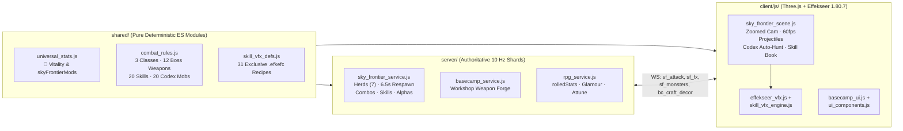

# ⚔️ Neora World V2 — Master Crafters MMORPG & Sky Frontier Handover

> **Last Updated**: 2026-10-27  
> **Project Root**: `/Users/thanapat/Documents/neora-world-v3/neora-world-v2` (ES Modules, Node.js >= 20 + Three.js r169 + EffekseerForWebGL 1.80.7)  
> **Test Suite Status**: **`470 / 470` passing (`0` failures)** via `npm test`  
> **Design North Star**: *WC3 Master Crafters ORPG* × *Ragnarok Online* (2% Monster Skill Scrolls & Habitat Grinding) × *Tree of Savior / Frieren* Cozy 2.5D Gouache Aesthetics

---

## 1. Read These Files First

| File | Responsibility |
| :--- | :--- |
| `shared/universal_stats.js` | Single authoritative 4-stat engine (`computeUniversalStats`, `skyFrontierMods`, `inspectItemAttune`, `STAT_META`). Rebrands internal `fortune` key to **`💖 Vitality`**. |
| `shared/combat_rules.js` | Pure deterministic rules: `MONSTERS` (16 species, `packSize: 7`), `BOSSES` (4 bosses), `ALPHA_ELITE`, `WEAPON_CLASSES` (`melee` / `ranged` / `magic`), `BOSS_WEAPON_FORGE` (12 boss weapons + 10-roll pity), `MONSTER_SKILLS` (20 drop-scroll skills), `buildMonsterCodex`. |
| `shared/sky_frontier_rules.js` | 4-region world geometry (`REGIONS`: `meadow`, `hollow`, `reef`, `caldera`), `NODE_TYPES`, `HARVEST_RARITIES`, energy, warehouse/pantry caps, field bounties, gate unlock logic. |
| `shared/catalog_gear_pets.js` | `ACCESSORIES` catalog including all `103` `gloves_*` items (`COMBAT_CLASSES`, `STARTER_WEAPON_IDS`, `12` `bossCraft: true` weapons, `6` Sovereign `★3` weapons) & `resolveWeaponClass()`. |
| `shared/accessory_attach.js` | `visibleSlotId(equipped, slot, glamour)` and `activeWeaponClass(equipped, glamour)` — ensures active combat class follows **`Glamour || Equipped`**. |
| `shared/skill_vfx_defs.js` | Declarative Pure-3D Effekseer recipes (`SKILL_VFX_DEFS`: `20` Monster Skills + `1` Charm Ultimate + `9` Class Combos + `ALPHA_ELITE_AURA_SPEC`) + `ChibiRig` choreography (`rigChoreo`). **100% URL-exclusive** (zero `.efkefc` reuse across recipes). |
| `server/sky_frontier_service.js` | Authoritative 10 Hz shard manager: habitat herd spawning (`packSize: 7`, `6.5s` respawn), passive vs pack AI, Alpha Elite telegraphs, `sf_attack` combos & `skillSlot` casts, persistent `skillZones`, Vitality `HP/s` regen, scroll drops. |
| `server/basecamp_service.js` | Tinker's Workshop `⚒️ Weapon Forge` handler (`bc_craft_decor` with `weapon_forge:roll|take|keep:<weaponId>`). |
| `server/rpg_service.js` | Syncs `rolledStats` & `forgeGrade` onto `profile.equipped.gloves`, supports `🎯 Gear Attunement` on rolled Boss Weapons, and grants Day-1 Starter Weapons on profile creation/migration. |
| `client/js/frontier/sky_frontier_scene.js` | 3D Sky Frontier scene, combat loop, max-range stop + `0`-hit self-healing, `📖 Skills` & `📖 Monster Codex` modals, Species-Locked Auto-Hunt (`🎯 Auto`), mobile HUD dock. **Edit surgically — never rewrite wholesale.** |
| `client/js/frontier/effekseer_vfx.js` & `skill_vfx_engine.js` | WebGL2 Effekseer 1.80.7 runtime with 60 FPS homing projectile flight (`at: 'projectile'` + live `targetRef` tracking) and `ChibiRig` cast choreography. |
| `client/js/basecamp_ui.js` & `ui_components.js` & `gacha_forge_ui.js` | Workshop `⚒️ Weapon Forge` UI (`Keep Current vs Take New Roll`), Wardrobe `⚔️ Hands & Weapon` tab, `💖 Vitality` stat drawer, and Blacksmith Attunement integration. |
| `.agents/skills/vfx-pipeline/SKILL.md` | End-to-end VFX audition, visual verification (`/?dev=1&vfx=1`), and 10-player GPU benchmark workflow (`scripts/shoot_skill_vfx.mjs`). |
| `.agents/skills/accessory-pipeline/SKILL.md` | Art slicing, palm-grip anchoring (`singleHand: true`), and 3-view `ChibiRig` verification pipeline for new weapons & accessories. |
| `tests/master_crafters_combat.test.js` | Comprehensive 17-section unit + WebSocket integration suite covering every weapon class, Boss Forge roll/pity/dupe, 20 Monster Skills, Alpha Elites, Vitality regen, and VFX file exclusivity. |

---

## 2. High-Level Architecture



---

## 3. Core Systems Implemented & Verified

### 3.1 Universal 4-Stat Quartet (`💖 Vitality` Rebrand)
- **Internal Backward Compatibility**: The JSON key in `profile` / `ACCESSORIES` / `PETS` remains `fortune` so zero legacy profiles or database rows break, while `STAT_META.fortune` (`shared/universal_stats.js`) rebrands all player-facing UI to **`💖 Vitality` (`VIT`)** across Wardrobe, Blacksmith, Basecamp, Village Plaza, Sky Frontier, and Cloud Dash (`💖 Collector`). All stale `"Island Defense"` tooltips were scrubbed.
- **Authoritative `skyFrontierMods(stats)` (`shared/universal_stats.js`)**:
  - **`🔥 Power`**: `attackDamageMult = 1 + softCap(power, 0.75, 150)` — scales **Basic `1–2–3` Combos, all Damaging Monster Skills, and Charm Ultimates**.
  - **`⚡ Swiftness`**: `moveSpeedMult = 1 + softCap(swiftness, 0.25, 140)` and `skillHasteMult = 1 + softCap(swiftness, 0.35, 150)` — speeds up movement, attack cadence, and **reduces Monster Skill cooldowns**.
  - **`💖 Vitality` (`fortune`)**:
    - **Max HP**: `playerMaxHp(level, stats) = 100 + 2 * level + round(softCap(vit, 140, 150))` (`+0..140` bonus Max HP).
    - **Passive `HP/s` Regen**: `hpRegenPerSec = 0.6 + softCap(vit, 4.4, 140)` (`0.60` → `5.00 HP/s` out of combat; **`50%` rate during active combat** within `2.5s` of taking a hit). Accumulates fractional HP every `1s` server tick and emits a clean consolidated **`💖 +N` green floating heal ticker every `10s`** (or on top-off) instead of spamming numbers every second.
    - **Goddess Outpost Sanctuary**: Standing within `5.5m` of an online Outpost after `4.0s` out of combat rapidly restores `12% Max HP/s`.
    - **Heal & Shield Power**: `healShieldMult = 1 + softCap(vit, 0.65, 150)` — boosts Magic Hit-3 party heal and all `💖 Vitality` support/shield Monster Skills.
    - **Gathering Yield**: `gatherYieldMult = 1 + softCap(vit, 0.50, 140)` — up to `+50%` bonus resource harvest yield.
  - **`🍀 Luck`**: `critChance = min(0.45, 0.08 + softCap(luck, 0.27, 140))` (`8%..45%` Crit at `1.55×` combo damage) and `rareFindMult = 1 + softCap(luck, 0.35, 140)` (multiplies Rare node drops and **Monster Skill Scroll drop rates**).

---

### 3.2 Unified `⚔️ Hands & Weapon` Slot, Glamour Class-Swap & `1–2–3` Combos
- **Unified Slot (`slot: 'gloves'`)**:
  - Renamed `🧤 Gloves` → **`⚔️ Hands & Weapon`** across Wardrobe and Blacksmith.
  - All `103` `gloves_*` items resolve to one of 3 combat classes (`melee`, `ranged`, `magic`) via `resolveWeaponClass(itemId)` (`shared/catalog_gear_pets.js`).
  - **3 Free Day-1 Starter Weapons (`starterCosmetic: true`)** automatically granted to every new and migrated profile:
    - `gloves_starter_sword` (*Traveler Oak Shortsword* — `⚔️ Melee`)
    - `gloves_starter_shortbow` (*Woodland Hunter Shortbow* — `🏹 Ranged`)
    - `gloves_starter_wand` (*Apprentice Dewdrop Wand* — `🪄 Magic`)
  - **Active Class Rule (`Glamour || Equipped`)**: `activeWeaponClass(equipped, glamour)` inspects `visibleSlotId(equipped, 'gloves', glamour)`. Players can keep a `+10` `SS Masterwork` weapon equipped for stats while **1-tap Glamour-swapping** into Sword, Bow, or Wand right inside the Sky Frontier **`📖 Skills`** modal (`wardrobe_glamour` `0 🪙`) to switch combat class anytime!
  - **Gathering Tool Separation**: `Pickaxe`, `Axe`, and `Herbalist Staff` (`frontier.toolbelt`) remain strictly for harvesting resource nodes; `ChibiRig` stows gathering tools automatically when entering combat.
- **3 Weapon Classes, Extended Ranges & 60 FPS 3D Projectiles (`shared/combat_rules.js`)**:

| Class | Range | Arc | Base CD | Combo Multipliers (`1–2–3`) | 3D Projectile / Swing | Hit-3 Signature Finisher |
| :--- | :---: | :---: | :---: | :---: | :--- | :--- |
| **`⚔️ Melee`** | `2.2m` | `135°` | `560ms` | `1.00× → 1.12× → 1.38×` | Wide cleave arcs | `0.95m` Knockback + `420ms` Stagger |
| **`🏹 Ranged`** | **`7.8m`** | `28°` | `520ms` | `1.00× → 1.08× → 1.44×` | 60 FPS homing 3D arrows/bolts (`at: 'projectile'`) | **Twin Starlight Volley**: fires `2` rapid hits (`2 × 0.56×` = `1.12×` on top of `1.44×`) |
| **`🪄 Magic`** | **`6.5m`** | `40°` | `600ms` | `1.00× → 1.10× → 1.25×` | 60 FPS homing 3D astral bolts/orbs (`at: 'projectile'`) | **Starburst Sanctuary**: `2.2m` AoE splash + heals self & Co-Op allies within **`7.5m`** (`5 × healShieldMult`) |

- **Sky Frontier Tactical Camera & Zero-Whiff Combat Sync**:
  - `CAMERA_PRESETS.SKY_FRONTIER` (`client/js/world_engine.js`): zoomed out to **`DIST: 28.5` (`MIN: 18, MAX: 40`), `PITCH_DEG: 38°`** so `6.5m–10.0m` ranged/magic kites and incoming Alpha telegraphs fit comfortably in mobile portrait (`393×852`) without HUD overlap.
  - **Max-Range Halt**: Characters automatically clear tap-walk (`clearMoveState()`) the instant they enter `range * 0.96` so Mages and Rangers stand cleanly at max range instead of walking into melee contact.
  - **Zero-Whiff Self-Healing**: Authoritative `sf_attack` returns `readyAt`, `serverNow`, `out_of_range` (with live monster `(x, z)`), or `no_target` without consuming cooldown. If `sf_attack` ever returns `0` hits on a live target, the client automatically steps `2.0m` closer and reconciles `sf_state` on repeat misses.

---

### 3.3 Tinker's Workshop `⚒️ Weapon Forge` (`12` Boss-Crafted Weapons)
- **Zero-`server.js`-Edit Protocol**: Routed cleanly through `bc_craft_decor` in `server/basecamp_service.js` using keys:
  - `weapon_forge:roll:<weaponId>`
  - `weapon_forge:take:<weaponId>`
  - `weapon_forge:keep:<weaponId>`
- **4 Region Boss Tiers (`3` Classes per Boss = `12` Weapons in `BOSS_WEAPON_FORGE.RECIPES`)**:
  1. **Whispering Meadow (`★2 Epic`, `Elder Moss Golem`, `base 18 / 14`, `1,500 🪙` + `3 boss_core_moss, 6 ingot, 6 plank`)**: `gloves_boss_moss_cleaver` (`⚔️`), `gloves_boss_moss_longbow` (`🏹`), `gloves_boss_moss_staff` (`🪄`).
  2. **Crystal Hollow (`★3 Mythic`, `Hollow Crystal Weaver`, `base 30 / 24`, `4,000 🪙` + `4 boss_core_weaver, 8 mithril_ingot, 6 crystal_glass`)**: `gloves_boss_weaver_scythe` (`⚔️`), `gloves_boss_weaver_bow` (`🏹`), `gloves_boss_weaver_cane` (`🪄`).
  3. **Celestial Sakura Reef (`★3 Mythic`, `Lady Tamamo`, `base 36 / 28`, `6,500 🪙` + `4 boss_core_kitsune, 12 sakura_timber, 10 celestial_pearl`)**: `gloves_boss_kitsune_blade` (`⚔️`), `gloves_boss_kitsune_bow` (`🏹`), `gloves_boss_kitsune_staff` (`🪄`).
  4. **Clockwork Star-Caldera (`★3 Pinnacle Mythic`, `Chronos-Solar Bahamut`, `base 42 / 34`, `9,500 🪙` + `4 boss_core_bahamut, 12 orichalcum_ore, 10 astral_prism`)**: `gloves_boss_bahamut_cleaver` (`⚔️`), `gloves_boss_bahamut_bow` (`🏹`), `gloves_boss_bahamut_staff` (`🪄`).
- **Random 2-Stat Rolling, Grades & `+1 Dupe` Loop**:
  - Rolls **2 distinct stats** from `['power', 'swiftness', 'fortune', 'luck']` multiplied by Grade:
    - **`B` Sturdy** (`50%`, `0.86×`) · **`A` Fine** (`32%`, `1.00×`) · **`S` Heroic** (`14%`, `1.15×`) · **`SS` Masterwork** (`4%`, `1.30×`).
  - **Master Smith `10-Roll` Pity** (`profile.basecamp.weaponForge.pity`): Roll `#10` without `S`/`SS` guarantees **`70% S` / `30% SS`**, resetting pity on any `S`/`SS` hit.
  - **Repeat Forge = `+1` Star-Force Dupe + `Keep vs Take`**: Every repeat anvil strike on an owned Boss Weapon **immediately adds `+1 dupe`** (`inventory[id].dupes += 1` so players can Star-Force refine Boss Weapons to `+10` and `🎯 Attune` their secondary rolled stat at `+5`), while saving `weaponForge.pending` for a side-by-side **Keep Current vs Take New Roll** choice that never overwrites existing `+Refine` or `attune`!

---

### 3.4 4-Region Living Ecology, Herds (`packSize: 7`) & Star-Crowned Alpha Elites
- **4 Connected Sky Frontier Biomes (`shared/sky_frontier_rules.js` & `shared/story_rules.js`)**:
  1. **`meadow` — Whispering Meadow** (`72m × 72m`, unlocked Day 1; Boss: *Elder Moss Golem* `2,800 HP`).
  2. **`hollow` — Crystal Hollow** (`64m × 64m`, Story Ch.2 `gate_hollow`; Boss: *Hollow Crystal Weaver* `5,200 HP`).
  3. **`reef` — Celestial Sakura Reef** (`72m × 72m`, Story Ch.5 `gate_reef`; Gatherables: `sakura_tree`, `pearl_clam`, `cloud_lotus`; Boss: *Lady Tamamo, Nine-Tail Kitsune* `7,800 HP`).
  4. **`caldera` — Clockwork Star-Caldera** (`72m × 72m`, Story Ch.6 completion; Gatherables: `orichalcum`, `astral_prism`, `mithril`, `crystal`; Boss: *Chronos-Solar Bahamut* `11,500 HP`).
  - **Couple Gate Guest Sharing**: Bound partners in the same shard can walk through region gates unlocked by either partner (`isRegionStoryUnlocked`).
- **Habitat Herd Spawning & Fast Respawns (`server/sky_frontier_service.js`)**:
  - **`packSize: 7` per species (`28` ambient monsters per region, `MONSTER_CAP: 96` on both server & client)**.
  - **`COMBAT.AMBIENT_RESPAWN_MS = 6500` (`6.5 seconds`)** — tuned specifically for continuous single-species hunting without idle downtime.
  - **Anti-Stacking `habitatPos()`**: Places monsters across a `1.6m–6.0m` ring around their named `habitatPoi` using golden-angle retry stepping, maintaining `>= 1.55m` separation between live monsters and `>= 1.15m` separation from gatherable boulder/tree props, while staying `> 5.5m` clear of `spawn`, `outpost`, and `gate_*`.
  - **Ecological AI (`Gentle Herd` vs `Pack Predator`)**:
    - `passive` grazers (*Moss Slime*, *Pollen Wisp*, *Zephyr Hare*, *Frostcap Myconid*, *Pearl Snapper*, *Cloud-Crane*) roam peacefully until struck, then retaliate (`provokedUntil`).
    - `pack` predators aggro on sight within **`AMBIENT_AGGRO_RANGE = 5.8m`** (preventing all 7 mobs across a 12m habitat from dogpiling a solo player at once) and rally nearby same-species packmates within **`PACK_ASSIST_RADIUS = 5.2m`** when hit.
    - **`13.0m` Habitat Leash**: Ambient mobs pulled `> 13m` from `(homeX, homeZ)` drop aggro and walk home.
  - **`60s` Empty-Region Hibernation & Instant Wake**: Empty regions clear idle ambient mobs after `60s` and instantly repopulate all `28` habitat monsters inside `combatSnapshot()` (`ensureRegionPopulated`) the millisecond a player enters.
- **Star-Crowned Alpha Elites (`ALPHA_ELITE`)**:
  - `8%` spawn chance on any ambient spawn (up to `2` active per region); `7`-tuple monster wire `[id, type, x, z, hp, maxHp, isEliteFlag]`.
  - `4.0× HP`, `1.45× DMG`, `1.45×` 3D scale + continuous golden Effekseer aura (`ALPHA_ELITE_AURA_SPEC`) + `⭐` mini-map marker.
  - **Telegraphed Signature Skill**: Every `7.5s`, plants a `3.4m` glowing danger ring (`alpha_telegraph`, `1,100ms` windup) before casting its species' real Monster Skill (`alpha_skill_cast`). **Stunning or freezing the Alpha mid-windup cancels the telegraph!**
  - **Rewards**: `3×` guaranteed material drops, `+150 🪙` Gold, and **`4×` Skill Scroll drop rate (`8.0%` base × `rareFindMult`)**.

---

### 3.5 `20` Monster-Dropped Skill Scrolls & Codex Species-Locked Auto-Hunt
- **Ragnarok-Style Pure RNG Scroll Hunting (`SKILL_DROP_RATES`)**:
  - **Field Monsters**: `2.0% × rareFindMult` · **Alpha Elites**: `8.0% × rareFindMult` · **Region Bosses**: `10.0% × rareFindMult` (pure RNG, no artificial pity on scroll drops so hunting rare scrolls stays exciting!).
  - **Co-Op Friendly**: Rolls independently for the killer AND every qualifying co-op contributor within `14m`.
  - **Auto-Leveling (`Lv.1 → Lv.5 MAX`)**: 1st scroll unlocks `Lv.1` (and auto-equips if Slot `0` or `1` is empty!); duplicates level up `Lv.2 → Lv.5`. Excess scrolls past `Lv.5` convert into **`1,200 🪙` (mob) / `3,000 🪙` (boss)**.
  - **`0` Energy Cost**: Skills use pure cooldowns (scaled by `⚡ Swiftness` Skill Haste) and cast via `sf_attack` `{ skillSlot: 0 | 1, targetId, targetX, targetZ, facing }` (fast combat path without full-profile WS spam; legacy `sf_ultimate` also stays backward-compatible).

| ID | Skill Name | Origin Monster | Region | Aim / Range | CD | Core Mechanic |
| :--- | :--- | :--- | :---: | :--- | :---: | :--- |
| `sk_pollen_ring` | 🌸 Golden Pollen Sanctuary | Pollen Wisp | Meadow | `4.4m` Self Zone | `14s` | `5s` persistent ground sanctuary healing Co-Op allies every `1s` (`💖 VIT`) |
| `sk_jelly_shield` | 🫧 Dewdrop Aqua Canopy | Moss Slime | Meadow | `4.2m` Self AoE | `12s` | `6s` `💖 VIT` Max-HP party shield + `40%` monster slow (`3s`) |
| `sk_tusk_rush` | 💨 Gale-Tusk Spiral Charge | Thornback Boar | Meadow | `5.2m` Dash Line | `7s` | `5.2m` forward dash + `🔥 PWR` line DMG + `0.85s` stun |
| `sk_zephyr_vault` | 🍃 Zephyr Backstep Volley | Zephyr Sylph-Hare | Meadow | `7.6m` Cone + Vault | `7.5s` | `70°` wind cone (`35%` slow) + `3.4m` backflip + `+30%` Attack Haste (`3.5s`) |
| `sk_earthshatter` | 🌲 Ancient Megalith Quake *(Boss)* | Elder Moss Golem | Meadow | `7.5m` Ground (`4.8m` r) | `15s` | Heavy `🔥 PWR` crater AoE + `1.5s` mob stun (`0.7s` boss stagger) |
| `sk_crystal_fan` | 💎 Prism Shard Volley | Crystal Beetle | Hollow | `7.2m` Cone (`62°`) | `6.5s` | Wide multi-target crystal cone (`🔥 PWR`) |
| `sk_echo_drain` | 🦇 Crimson Lantern Siphon | Lantern Bat | Hollow | `3.8m` Self AoE | `10s` | `🔥 PWR` AoE + leeches `25%` damage dealt as HP |
| `sk_gravity_spin` | 🪨 Astral Mandala Vortex | Quartz Golemling | Hollow | `4.6m` Pull AoE | `11s` | Pulls non-boss mobs inward to `1.1m` + `🔥 PWR` AoE cleave |
| `sk_frost_nova` | ❄️ Permafrost Spore Nova | Frostcap Myconid | Hollow | `4.5m` Self AoE | `11.5s`| Freezes mobs `1.6s` (`+15%` shatter vuln) + `50%` chill (`4s`) |
| `sk_prism_beam` | 🕸️ Celestial Prism Ray *(Boss)* | Crystal Weaver | Hollow | `10.0m` Piercing Line | `16s` | `10.0m × 1.9m` piercing starlight laser (`🔥 PWR`) |
| `sk_foxfire_wisps`| 🦊 Nine-Shrine Foxfire Orbs | Sakura Kitsune | Reef | `8.6m` 3-Orb Homing | `8.5s` | Fires `3` homing spirit orbs (focuses `1` boss for `1.65×` or splits up to `3` mobs) |
| `sk_mirror_shell` | 🦪 Tide-Pearl Mirror Carapace| Pearl Snapper | Reef | `4.6m` Self AoE | `13s` | `5s` `💖 VIT` shield + `45%` DMG reduction + **`35%` water thorns** + AoE pulse |
| `sk_tailwind_gale`| 🦢 Celestial Crane Tailwind | Cloud-Crane | Reef | `5.5m` Party Buff | `12.5s`| Instant `💖 VIT` party heal + `+35%` Haste & `+20%` Crit (`6s`) |
| `sk_koi_whirlpool`| 🌊 Turquoise Tide Whirlpool | Tide-Bell Spirit | Reef | `7.8m` Ground (`4.6m` r) | `12s` | `4s` persistent whirlpool zone pulling mobs inward & pulsing `4×` `🔥 PWR` DMG |
| `sk_sakura_tempest`| 🌸 Nine-Tail Blossom Tempest *(Boss)*| Lady Tamamo | Reef | `5.6m` Follow Storm | `16.5s`| `3s` caster-following storm dealing `3×` `🔥 PWR` DMG to foes & healing allies |
| `sk_solar_meteor` | ☄️ Cinder-Star Meteor Drop | Cinder Salamander | Caldera | `8.2m` Ground (`4.4m` r) | `10.5s`| Heavy `🔥 PWR` meteor impact + `2s` burning crater (`solar_burn` zone) |
| `sk_chain_lightning`| ⚡ Aether-Coil Chain Arc | Aether-Owl Auto | Caldera | `8.5m` Chain (`4`x) | `7.5s` | Bounces across up to `4` mobs (`6.0m` jump), `🔥 PWR` DMG + `0.55s` stun |
| `sk_star_brand` | 🌠 Astral Griffon Judgement | Star-Gargoyle | Caldera | `8.0m` Ground (`4.2m` r) | `11s` | `🔥 PWR` AoE + brands foes with **`+25%` party damage vulnerability (`5s`)** |
| `sk_time_dilation`| ⏳ Chronos Astrolabe Field | Chrono Sentinel | Caldera | `5.0m` Self AoE | `14s` | `65%` slow (`4.5s`) + DMG + **rewinds `2.5s` off your other Skill slot CD!** |
| `sk_supernova_cleave`| ☀️ Solar-Bahamut Supernova *(Boss)*| Solar Bahamut | Caldera | `8.5m` Cone (`95°`) | `17.5s`| Colossal `95°` solar cataclysm (`🔥 PWR`) + `1.4s` stun |

- **Monster Codex & Species-Locked Auto-Hunt (`client/js/frontier/sky_frontier_scene.js`)**:
  - Accessible from **`📖 Skills` → `📖 Monster Codex`** AND **`🗺️ Mini-Map` → `👾 Monsters`**.
  - Shows live shard population + active `⭐ Alpha` count, habitat coordinates, `🌿 Gentle Herd (7)` / `⚔️ Pack Predator (7)` badges, kill mastery (`10 / 30 / 75`), guaranteed material drops, and Luck-adjusted Skill Scroll drop %.
  - Clicking **`🎯 Hunt <Species>`** sets `this.lockedHuntMobId` and `this.lockedHuntAnchor`, morphs the `#sf-auto-toggle` pill to display the **target monster's portrait avatar (`🎯 Auto`)**, strictly filters auto-targeting to ONLY that species, smart-casts equipped skills in range, and waits calmly at the habitat anchor between `6.5s` respawns without wandering off to harvest trees/rocks.

---

### 3.6 Pure 3D Effekseer (`1.80.7`) VFX Engine & Studio (`/?dev=1&vfx=1`)
- **Zero-2D-Decal Pure 3D Pipeline**:
  - Uses pre-built CC0 Effekseer `.efkefc` particle/ribbon/shader packages in `client/assets/vfx/effekseer/` driven by `EffekseerVfxManager` (`client/js/frontier/effekseer_vfx.js`).
  - **100% `.efkefc` Exclusivity**: Automated unit test (`Test 10` in `tests/master_crafters_combat.test.js`) enforces that all `31` recipes (`20` skills + `1` ultimate + `9` class combos + `1` Alpha aura) use **completely distinct `.efkefc` files** on disk (`0` duplicates).
  - **Critical Projectile Rule (`at: 'projectile'`)**:
    - When authoring moving projectiles in `shared/skill_vfx_defs.js`, **ONLY** use local-space parent-following `.efkefc` emitters (e.g. `Basic_Homing_Laser01`, `Basic_Laser02`, `Basic_Simple_Track1`, `Basic_Simple_Sprite_BillBoard`, `MxS_Lance3`, `Tktk01_Arrow1`). Emitters like `Pierre02_FireBall.efkefc` bake world-space position at `t=0` and ignore `handle.setLocation()`, so keep those strictly on `'caster'` muzzle flares or `'target'` impacts!
- **Visual Studio & 10-Player Benchmark**:
  - Interactive browser studio: `http://localhost:4000/?dev=1&vfx=1` (`client/js/frontier/vfx_studio.js`).
  - Headless contact-sheet & 10-player benchmark CLI:
    ```zsh
    cd /Users/thanapat/Documents/neora-world-v3/neora-world-v2
    node scripts/shoot_skill_vfx.mjs --all --combos --bench-10p
    ```
  - Current 10-player simultaneous cast benchmark: **`~2.4ms` avg / `3.5ms` p95 frame time, `17` draw calls** (well under the `16.6ms` 60 FPS budget).

---

### 3.7 Master Crafters Build-Craft Layer (Combos, 4 Slots, Passives, Archetypes, Guard) — added 2026-10-27
All rules live in the pure module **`shared/skill_combos.js`** (server-authoritative, client imports the same tables). Server integration is in `server/sky_frontier_service.js` (`comboHit`, `chipPoise`, `noteReactions`, rewritten `castMonsterSkill`, class-combo path of `attack`, `tickSkillZones`, `tickMonsters`).

- **Unified hit pipeline (`comboHit`)**: every skill hit, basic combo hit and zone tick goes through one data-driven path — resolve reactions against the target's *current* tags → reaction × elemental multiplier → `damageMonster` (adds Marked +15%, Armored Guard −45%, Broken +50%, Ward absorb) → reaction side effects → tag consumption → Guard chip → apply this hit's own tags (`SKILL_COMBO[skillId].applies`). A skill never combos with itself.
- **Status tags** (`STATUS_TAGS`, wire bitmask): Soaked, Burning (DoT 12%/s), Shocked, Chilled (−25% speed), Gathered, Staggered, Marked (+15% dmg taken) + derived Frozen / Stunned / Broken / Warded.
- **7 Reactions** (`REACTIONS`): Conduction (Shock→Soaked: ×1.5, stun, Chain +3 bounces), Deep Freeze (Frost→Soaked: 2× freeze), Shatter (Heavy→Frozen: +60%), Wildfire (Wind→Burning: spreads 3m), Scald (Fire↔Water: 30% enemy miss), Crush (Ground AoE→Gathered: +40%), Exposed (any skill→Stunned/Staggered: guaranteed crit). Cap ×2.5. Reactions work **across players** (co-op combos). First discovery per player: **+30 💎** (`profile.frontier.skills.reactionsFound`). ⏳ `sk_time_dilation` = Time Lock (+50% status duration) + refunds 2.5s on ALL other slots.
- **Weapon Echo** (`WEAPON_ECHO`): Melee = self-AoE/dash +20% radius & every skill hit Staggers · Ranged = cone/line/homing/chain +25% range & +1 orb/bounce · Magic = zones +1 pulse & statuses +30%. **Hit-3 primes** (`HIT3_PRIMES`): Melee Stagger+Heavy (can Shatter), Ranged Mark (3s, on the 2nd volley arrow), Magic extends statuses +1s.
- **4 active slots + 1 Passive slot**: slots 1–2 always, slot 3 at Lv.12 / Story Ch.3, slot 4 at Lv.25 / 6 species mastered (30 kills). Legacy 2-slot profiles auto-migrate via `normalizeFrontierSkills`.
- **8 Monster Passives** (`MONSTER_PASSIVES`, 1.2% / ⭐ Alpha 5% × Luck, Lv.1→3): Thornhide (−dmg taken), Mossgel (+HP/s), Bloodthirst (basic leech), Frostcap Touch / Foxfire Trail (Hit-3 tags), Tide-Pearl (+shield), Static Core (basic Shock chance), Star-Sight (+crit).
- **Loadout presets** (3, `preset_save` / `preset_load`, includes glamour weapon; locked for 4s after combat). **Skill Essence**: excess Lv.5 scrolls/passives → Essence (+gold kept); craft any skill/passive whose source you have killed ≥10 (boss ≥1) times (6 / 15 boss / 8 passive). **Bad-luck floor**: first scroll guaranteed at 30 kills (boss: 5) — `floor: true` in `skill_scroll_drop`.
- **Monster archetypes** (`MONSTER_ARCHETYPE_BY_TYPE`): 🛡️ Armored (pearl snapper, golemling, chrono sentinel), 🐝 Swarm (pollen wisp, lantern bat), 🪽 Kiter (zephyr hare, cloud crane, arc automaton), 🔔 Support (bell spirit, frost shroom — wards allies, interrupted by stun), 🌋 Elemental (crystal beetle frost, cinder salamander fire: immune/resist own, weak to opposite).
- **Guard (poise)**: Bosses 100, Alpha Elites 60, Armored 40. Stuns (25), staggers (10), heavy hits (12), reactions chip it; at 0 → **Guard Break** (4s +50% dmg, 2s stun, cancels telegraphs, `guard_break` fx).
- **Wire changes**: `sf_monsters` tuple `[id, type, x, z, hp, maxHp, isElite, tagMask, poise]` (poise `null` / `-1` broken / `0..100`); `bossWire` + `poise/maxPoise/breakUntil`; `reactions: [[monId, reactionId, x, z, by]]` on `attack` / `monster_skill` / `zone_tick`; new fx kinds `reaction_discovered`, `guard_break`, `mob_ward`, `passive_drop`; `sf_pouch_set` actions `equip (0..3)`, `passive_equip`, `preset_save`, `preset_load`, `essence_craft`; error `slot_locked`.
- **VFX & art**: 9 exclusive pre-built Effekseer recipes in `COMBO_VFX_DEFS` (`reaction_*`, `guard_break`, `mob_ward`, resolved by `resolveSkillVfxRecipe`); 16 painted icons in `client/assets/combo/` (`tag_*.png`, `guard_break.png`, `ps_*.png`; source sheet `art_src/sheet_combo_tags_passives.jpg`).
- **Client** (`sky_frontier_scene.js`): 2×2 skill cluster + passive chip (zero-overlap at 393×852), keys 1–4, combo-aware smart auto-cast (payoff → setup → any), tag sprites & Guard bars over monsters and on the boss bar, reaction floating text + VFX, Skill Book tabs (Skills with "Combos with…" chips / Passives / Reactions / Codex with archetypes), presets & Essence craft.
- **Tests**: `tests/skill_combos.test.js` (12 suites) + `tests/combo_vfx.test.js`; full suite **470 / 470**.
- **Round 2 (production hardening)**:
  - **+3 reactions → 10 total**: ❄️🍃 Frostwind (Wind→Chilled: freezes 1.2s, enables Shatter chains), ✨🌠 Judgement (Light→Marked: ×1.6, heavy Guard dmg), 🩸 Siphon (Drain→any elemental status: +30% & double leech). Conduction triggers both ways (Shock→Soaked or Water→Shocked). Every one of the 20 skills now has a combo role (setup, payoff, Resonance primer or Time Lock).
  - **🎶 Resonance** (`RESONANCE`): any Sustain/Support cast primes your next damaging skill within 5s (+25% DMG, statuses +50%) — makes heal/shield skills part of combos. Wire: `resonancePrimed` / `resonanceUsed` on `monster_skill`, `buffs.resonanceUntil`.
  - **Crowd-scaled farming**: each extra player in a region adds +2 mobs per habitat herd (max +6 → 13/species, 52/region) and speeds respawns 12% per player (min 3.5s) — `COMBAT.AMBIENT_PER_EXTRA_PLAYER / AMBIENT_CROWD_MAX / AMBIENT_RESPAWN_MIN_MS`.
  - **Sync fixes**: boss HP/Guard pushed via throttled `sf_boss {event:'update'}` (≤4 Hz) on damage/poise change/regen; `preset_load` dedupes skills (no 4× same skill exploit); expired tags pruned each tick.
  - VFX: 13 exclusive `COMBO_VFX_DEFS` (+`reaction_frostwind`, `reaction_judgement`, `reaction_siphon`, `resonance_prime`).

---

## 4. Profile Persistence & Wire Protocol Quick Reference

### Profile Fields Added / Used
```js
profile.equipped.gloves = {
  id: 'gloves_boss_kitsune_bow',
  refine: 7,
  rolledStats: { power: 41, swiftness: 32 }, // synced from inventory[id]
  forgeGrade: 'S',                           // 'B' | 'A' | 'S' | 'SS'
  attune: { stat: 'luck', count: 1 },        // optional +5 Gear Attunement
};
profile.glamour.gloves = 'gloves_starter_wand'; // optional 0-gold visual + combat-class override!
profile.inventory[weaponId] = {
  refine: 7, dupes: 3, pity: 0,
  rolledStats: { power: 41, swiftness: 32 },
  forgeGrade: 'S',
};
profile.basecamp.weaponForge = {
  pity: 4,                                   // 0..9 (10th roll guarantees S/SS)
  pending: null,                             // or { weaponId, grade, gradeLabel, rolledStats, pityHit }
};
profile.frontier.skills = {
  unlocked: { sk_pollen_ring: 5, sk_foxfire_wisps: 2 }, // skillId -> Lv 1..5
  equipped: ["sk_foxfire_wisps", "sk_pollen_ring", null, null], // 4 slots (3rd Lv.12 / 4th Lv.25)
  passive: "ps_static_core", passives: { ps_static_core: 2 }, presets: [null, null, null], essence: 0, reactionsFound: {},
};
profile.frontier.stats.killsByMob = { thornback_boar: 42, ... };
profile.frontier.stats.elites = 5;
```

### Key WebSocket Messages
- **`sf_attack` (Basic Class Combo)**: `{ type: 'sf_attack', targetId, facing, comboStep: 1|2|3 }` → returns `{ ok, weaponClass, comboStep, vfxId, crit, hits, partyHeals, cooldownMs, readyAt, serverNow }` (or `{ ok: false, error: 'out_of_range' | 'no_target' | 'cooldown' }`) and broadcasts `sf_fx` (`kind: 'attack'`).
- **`sf_attack` (Monster Skill Fast-Path)**: `{ type: 'sf_attack', skillSlot: 0|1, targetId, targetX, targetZ, facing }` → casts equipped Monster Skill with zero full-profile broadcast overhead, returning `{ ok, skillSlot, skillId, level, cooldownUntil, cooldownMs, skillCds, buffs, pos, hits }` and broadcasting `sf_fx` (`kind: 'monster_skill'`).
- **`sf_pouch_set` (Equip Monster Skill)**: `{ type: 'sf_pouch_set', skillAction: 'equip', slot: 0|1, skillId: 'sk_...' | null }` → swaps cleanly if already in the other slot.
- **`bc_craft_decor` (Workshop Weapon Forge)**: `{ type: 'bc_craft_decor', decor: 'weapon_forge:roll:<weaponId>' | 'weapon_forge:take:<weaponId>' | 'weapon_forge:keep:<weaponId>' }`.
- **`sf_monsters` (5 Hz Delta)**: `{ type: 'sf_monsters', regionId, m: [[id, type, x, z, hp, maxHp, isEliteFlag], ...] }` (`hits` in `sf_fx` use 6-tuple `[id, dealt, crit, monHp, newX, newZ]`).
- **`sf_player_hp`**: `{ type: 'sf_player_hp', id, hp, maxHp, shield, shieldHp, downUntil, source?, regenPerSec?, vitalityTickHeal? }`.

---

## 5. Strict Safety Rules & Operational Gotchas (MUST FOLLOW)

> [!CAUTION]
> **Live Database & Protected Accounts**
> 1. **NEVER** modify, overwrite, or point test/QA scripts at `/Users/thanapat/Documents/neora-world-v3/neora-world-v2/server/data/local_db.json`. Always pass an isolated `/tmp/neora_qa_...` `dataFile` to `startServer({ port: 0, dataFile, quiet: true })` in tests and Puppeteer scripts!
> 2. **NEVER** log in as, mutate, or touch live user accounts `nook` or `neen` during automated QA. Always create synthetic test accounts (e.g. `qa_hero_1`, PIN `1234`).
> 3. **Keep `server/server.js` & WebRTC `voice_call_*` Frozen**: Route new Basecamp actions through `basecamp_service.js` (`bc_craft_decor` / existing `bc_*` handlers) and Sky Frontier actions through `sky_frontier_service.js` (`sf_attack` / `sf_pouch_set` / `sf_state`) so `server/server.js` and live voice calls stay untouched.

- **Restarting the Dev Server After Editing `server/*` or `shared/*`**:
  - Static `client/*` and `shared/*` files are served fresh to browsers on page reload, **but Node.js caches ES modules in RAM at process startup**.
  - Whenever you change `server/sky_frontier_service.js` or `shared/combat_rules.js` (ranges, damage, spawn counts, skills), gracefully restart the live port `:4000` server (`SIGINT` triggers `srv.close()` → `db.close()` flush) so client & server rules never drift!
- **Mobile Portrait `393×852` Zero-Overlap Law**:
  - Every Sky Frontier HUD element (`#sf-bottom-right-dock`, `#joystick`, `#sf-hp-bar`, `#sf-minimap-btn`, `#bc-sf-quest`, `#bc-sf-pouch`, `#sf-boss-bar`, `#sf-scroll-banner`) must have **0 pairwise bounding-box overlaps** at `393×852` (`deviceScaleFactor: 2`). Modals (`#sf-skill-modal`, `#sf-minimap-modal`, `#sf-bounty-modal`) must auto-hide background side docks while open.
- **Puppeteer Headless Chrome Cleanup**:
  - Always `await browser.close()`, `await srv.close()`, and `fs.rmSync(tmpDir, { recursive: true, force: true })` inside a `finally` block, and check `ps aux | grep puppeteer_dev_chrome_profile | grep -v grep` after QA runs so SwiftShader never leaks CPU cores.

---

## 6. Recommended Next Development Directions

1. **Co-Op Instanced Boss Dungeons / Elemental Trial Towers**:
   - Build 2–4 player instanced multi-room boss trials entered from Sky Frontier shrines, featuring multi-phase boss mechanics (safe-zone runes, tether mechanics with `💞 Couple Resonance`, elemental shield break checks using `melee` / `ranged` / `magic` + Monster Skills).
2. **Monster Skill Scroll Synthesis, Loadout Presets & 3rd Passive Slot**:
   - Add an **Arcane Scriptorium** tab (or Skill Book tab) allowing players to fuse excess `Lv.5` scroll essence into targeted **Boss Relic Scroll Tomes**, save `3` named Skill + Glamour Weapon presets (`Solo Farm`, `Co-Op Healer`, `Boss Raid`), or unlock a **Monster Passive Crest** slot at Codex Mastery `75` kills!
3. **Weapon Set Bonuses & Elemental Affixes in `⚒️ Weapon Forge`**:
   - Add optional **Master Crafter Relic Sockets / Elemental Enchantments** (using Alpha Elite trophies or Region 3/4 rare materials) that add unique proc passives to Boss-Crafted Weapons without breaking Cloud Dash / Monopoly stat balance.
4. **Region 5 Expansion (*Celestial Astral Sanctum / Sunken Atlantis*)**:
   - Everything is data-driven: add the region to `REGIONS` (`shared/sky_frontier_rules.js`), add 4 habitat species (`packSize: 7`) + 1 Boss + 3 Boss Weapons + 5 Monster Skills in `shared/combat_rules.js`, add 5 exclusive `.efkefc` recipes in `shared/skill_vfx_defs.js` (verified via `vfx-pipeline`), and add `NODE_PLAN` entries in `server/sky_frontier_service.js`.
